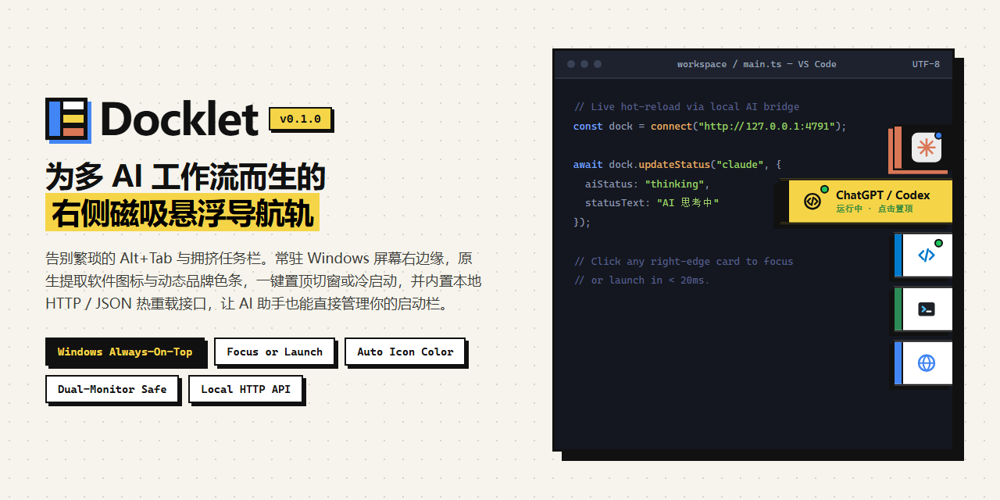
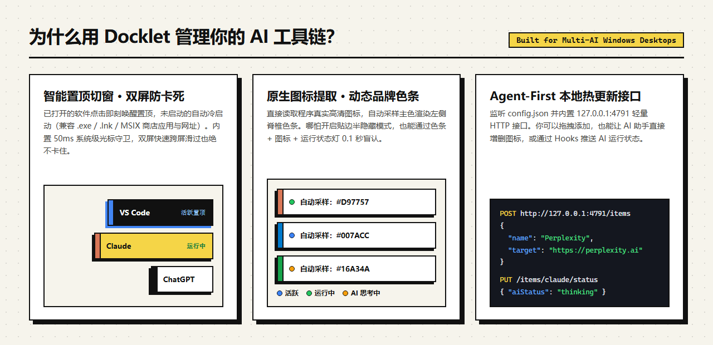

<div align="center">



# Docklet

**为多 AI 工作流而生的 Windows 右侧磁吸悬浮导航轨**  
*A tactile, right-edge magnetic quick-launcher & window switcher built for multi-AI workflows on Windows.*

[](./LICENSE)
[](#)
[](https://github.com/Ronanism/docklet/releases)

</div>

---

## 为什么做 Docklet？

当你同时开着多个 AI 编程助手、代码编辑器、终端与浏览器来回切换时：
- `Alt + Tab` 窗口一多就眼花缭乱，顺序还不停跳动；
- 底部任务栏塞满图标，根本分不清谁在跑、谁没开；
- 很多 AI 工具支持 Hooks 或脚本，却缺少一个轻巧常驻的桌面视觉入口。

**Docklet** 把宽屏右侧的闲置边缘变成一套**实体文件夹索引贴**：平时整齐贴边只露品牌色条与原图标，鼠标滑过瞬间向左抽出，点击即刻**置顶切窗或冷启动**——既不挡视野，又让高频工具 0.1 秒盲认直达。



---

## 核心特性

- **智能切窗 / 冷启动（Focus or Launch）**  
  点击任意色卡：软件已打开则直接唤醒并置顶到最前景（兼容最小化窗口）；未启动则自动拉起。支持 `.exe`、`.lnk` 快捷方式、Windows Store / MSIX 应用（`shell:AppsFolder\...`）以及网页 URL。
- **原生图标提取 + 动态品牌色条**  
  自动提取每个软件真实的 Windows 高清图标，并通过像素色相聚类采样出高饱和主色，实时渲染到左侧脊椎色条。
- **贴边半隐藏 + 实时运行状态灯**  
  开启贴边模式（快捷键 `Alt + Space`）后，所有卡片整齐收纳至屏幕右边缘，透明区域完全鼠标穿透；图标右上角实时显示 **活跃（蓝点） / 运行中（绿点） / AI 思考中（橙点）**。
- **双屏跨屏防卡死**  
  内置 50ms 系统级光标守卫（`screen.getCursorScreenPoint()`），即使在双屏之间高速跨屏滑过色卡轨，卡片也会立刻平滑缩回，绝不卡在突出状态。
- **零干扰交互**  
  顶部控制条默认完全隐藏，仅在悬停色卡轨或右键菜单时出现；支持直接将 `.exe` / `.lnk` 拖拽到色卡轨上添加入口。
- **Agent-First 双通道热更新**  
  同时支持监听本地 `config.json` 与内置 `http://127.0.0.1:4791` 轻量 HTTP 接口——你可以自己配置，也可以直接让你的 AI 助手一句话帮你增删排序，并为二期实时展示 AI 运行状态预留了完整协议。

---

## 快速开始

### 环境要求
- Windows 10 / 11
- Node.js 18+

### 安装与运行

```bash
git clone https://github.com/Ronanism/docklet.git
cd docklet
npm install
npm start
```

首次启动会自动从 `config.example.json` 生成本地专属的 `config.json`（已加入 `.gitignore`，不会泄露你的本地路径与个人软件）。

### 常用操作
- **切换贴边半隐藏**：按全局快捷键 `Alt + Space`，或右键任意色卡切换。
- **添加软件**：直接把桌面快捷方式（`.lnk`）或 `.exe` 拖到右侧色卡轨上，或右键 →「打开色卡配置」。
- **退出程序**：右键任意色卡或右下角系统托盘图标 →「退出 Docklet」。

---

## 本地 HTTP API（AI 助手接口 & 二期状态协议）

Docklet 启动后会在本机监听 `http://127.0.0.1:4791`（仅限本机回环访问）：

| 方法 | 路径 | 说明 |
| :--- | :--- | :--- |
| `GET` | `/health` | 检查服务状态与当前条目数 |
| `GET` | `/items` | 获取当前所有色卡配置 |
| `POST` | `/items` | 新增或更新一个色卡入口（毫秒级热生效） |
| `PUT` | `/items/:id/status` | 更新指定入口的 AI 运行状态（`thinking` / `done` / `attention` / `null`） |
| `DELETE` | `/items/:id` | 删除指定入口 |

**示例：通过 AI 助手或本地脚本动态添加一个入口**

```bash
curl -X POST http://127.0.0.1:4791/items \
  -H "Content-Type: application/json" \
  -d '{"name":"Perplexity","target":"https://perplexity.ai"}'
```

**示例：在 AI Hook 中推送“思考中”状态**

```bash
curl -X PUT http://127.0.0.1:4791/items/claude/status \
  -H "Content-Type: application/json" \
  -d '{"aiStatus":"thinking","statusText":"AI 思考中"}'
```

---

## Roadmap

- [x] **v0.1.0**：Windows 右侧磁吸撞色色卡轨、Win32 Focus-or-Launch、贴边半隐藏、原生图标与动态取色、双屏防卡死、本地 JSON / HTTP 热重载
- [ ] **v0.2.0**：内置主流 AI CLI / Agent 的一键 Hook 接入模板（实时展示思考中 / 等待确认 / 任务完成）
- [ ] **v0.3.0**：同类多窗口快速轮切、拖拽排序与免 Node.js 安装包（`.exe` / Portable）

---

## License

[MIT](./LICENSE) © 2026 Ronanism
